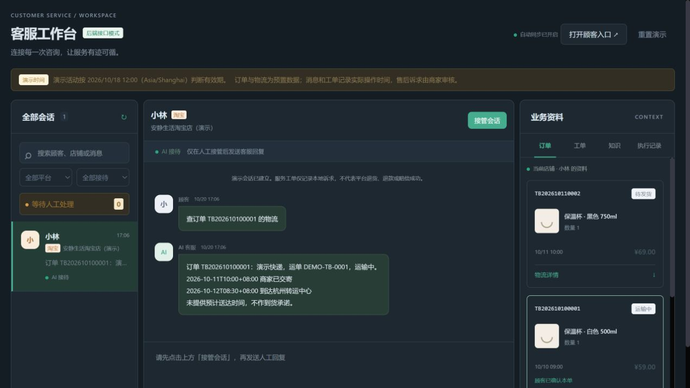
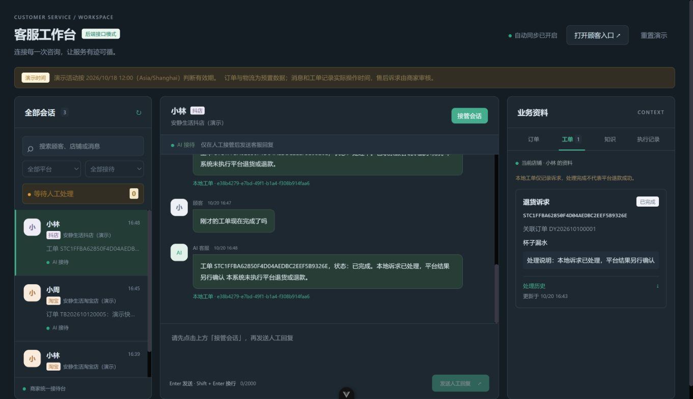

# run11：事务、并发与双端业务验证

日期：2026-10-20，Asia/Shanghai。运行基线 `1d4bbc859a061a8cb8348dc2b3205c2d019ec37c`，报告中的 `workspaceDirty=true` 表示使用该基线上的本轮未提交源码；本目录随修复代码一并提交。

## 修复及回归

1. 首次可靠性运行16组通过、1组失败；“签收后几天可以申请退货？寄回运费怎么办？”被错误当成写诉求。[原始报告](reliability-first.json)保留失败。增加政策意图判断，同时保留明确“想退货/帮我申请退货”等写诉求。回归强制模型返回 RETURN_EXCHANGE，验证两平台仍返回规则且不残留待确认。
2. 商家状态更新原先缺会话执行记录。新增 `MerchantTicketService`，以同事务提交工单状态、处理历史及 `update_service_ticket SUCCESS`；失败后独立事务尝试记 FAILED。伪造店铺不能污染其他会话；完整数据库不可用时失败记录也可能无法保存。
3. [最终可靠性报告](reliability-final.json)：17 PASS / 0 FAIL。真实 MySQL13307、真实业务服务/API10003，模型为回环 fixture，**不是供应商模型结果**。[运行方法与注入限制](../../scripts/README.md)。

| 自动化 | 实际结果 | 证据 |
|---|---|---|
| Java后端 | 10个suite、83项，失败/错误/跳过均0 | [测试摘要](automated-checks.json)，源自本轮Surefire XML |
| Vue工作台及commerce适配 | 14 PASS / 0 FAIL | [前端测试输出](frontend-tests.txt) |
| C离线检查器 | 26 PASS / 0 FAIL | [检查器输出](checker-tests.txt) |
| Vue类型及生产构建 | PASS | [构建摘要](frontend-build-summary.txt)；构建成功不等于已部署 |

可靠性覆盖首次并发确认返回处理中409、完成重放/未结复用、响应丢失原键重试；模型响应前和响应后finish事务前接管；查询异常及MySQL45000触发的创建/更新事务回滚、恢复重试；模型不可用、500、1000ms读超时、坏JSON、未知意图；范围查询、待确认撤销、知识和人工协作、重置。hold-before-finish 不代表已经持商家锁后的暂停；脚本disabled 是验收包装器返回不可用。

另用 [AcceptanceDisabledRuntime.java](../../scripts/AcceptanceDisabledRuntime.java) 在10005以真实 `llm.enabled=false` 启动，校验原始LlmService Bean和实际关闭配置；[5项检查通过](disabled-config-live.json)：真实物流查询、写诉求转人工且不建单、人工消息持久化、历史/工单读取、演示数据清理。最长单次请求332ms。该启动器不读取真实模型key；真实关闭启动与wrapper证据分别保存。

## 静态文件与同源API

`build:demo` 通过Vue类型检查并打包真实API模式，`serve:demo` 在127.0.0.1:20003提供 `dist`，同源 `/api` 代理至10002；不依赖Vite开发代理。[构建摘要](static-demo-build-summary.txt)与[HTTP结果](static-demo-live.json)分别保存构建、资源MIME、同源真实API、路径穿越及缺失资源404检查。

浏览器新建淘宝小林会话 `446a109d-5349-4d7b-9a81-aa30578332a2`，查询TB01物流取得杭州节点及 `get_logistics SUCCESS`；[顾客页面](18-static-customer.txt)、[商家同会话](19-static-merchant.txt)与[刷新后恢复](20-static-refresh.txt)均留档。刷新后需重新选择淘宝小林并点击“恢复最近会话”；默认身份不自动恢复。此会话保留供本机查看，当前没有演示工单，之前三故事已重置。仅验证本地静态服务，公网生产部署尚未完成。

## 真实模型、真实MySQL双端

浏览器通过20002的API模式连接10002；模型使用本地配置中的 `gpt-6-sol`，只发送演示资料，未将密钥纳入证据。网关此前偶发超20秒，本轮成功不能证明长期稳定。

| 故事 | 实际会话/编号 | 证据 |
|---|---|---|
| 淘宝小林：杯子多单→选TB01→“这个”仍查同单物流 | `998e28e1-a93a-4cc9-a3f0-9e12ee51f714` | [物流截图](01-logistics.png)、[指代结果](01-logistics-dom.txt) |
| 抖店小林：确认新建→处理中→已完成→顾客追问同号 | `f04241b8-a084-4652-bb6b-9179614da2a3`；工单 `STC1FFBA62850F4D04AEDBC2EEF5B9326E` | [确认前](02-return-before-confirm.txt)、[更新执行记录](03-ticket-update-dom.txt)、[处理中](04-customer-progress.txt)、[已完成](10-customer-completed.txt) |
| 淘宝小周：延迟、500元诉求→等待人工→接管→3条顾客消息无AI→人工回复→交回后新消息查询 | `3b2c33af-2689-4e46-beba-48bf8bb8585e` | [摘要](05-handoff-summary.txt)、[等待窗口后](06-human-after-window.txt)、[交回前置](07-return-ai-before-new-message.txt)、[新消息结果](07-return-ai-response.txt) |

顾客刷新后点击“恢复最近会话”，商家自动恢复所选会话；[顾客刷新](11-refresh-customer.txt)、[商家刷新](11-refresh-merchant.txt)保留原工单及已完成状态。双端业务全快照另存 [ui-before-reset.json](ui-before-reset.json)。本轮没有重复后端进程重启；重启前后10会话完整对照见run10。

## 切换与重置

- 商家在淘宝/抖店小林之间往返5次，保存[逐次DOM](09-session-switches.json)。没有单独保留每个请求的sessionId和请求中切换录像，因此 AC-02 仅部分覆盖，不能据此证明所有慢响应组合。
- [重置弹窗](14-reset-dialog.txt)先取消；[三会话完整快照比较](reset-ui-cancel.json)全部 identical=true。
- 然后连续两次通过UI确认。[首次计数](reset-ui-first-state.json)、[第二次计数](reset-ui-second-state.json)均为1商家/2店/5顾客/12订单/7物流/0工单，消息、执行记录、提交及处理历史为0；保留1条非演示会话、10条演示知识及1条非演示知识。
- [非演示前](sentinel-before-ui-reset.json)与[后](sentinel-after-ui-reset.json)逐字段一致；仅这两类哨兵证明范围内保留，不泛化为所有第三方资料。
- 顾客旧标签自动清空旧会话并回到“开始咨询”，[页面](16-reset-customer.txt)；三个原会话[均返回404](reset-ui-old-sessions.json)。处理中任务的重置取消由可靠性/既有回归单独覆盖。
- 数据库原始表JSON快照写入本机忽略目录 `backend/target/acceptance-backup-*`，不提交，也不声称可一键SQL还原。

## 交付边界

[截图步骤回放](replay.html)可按步骤查看业务实测，**不是实时录屏、不是完整MP4**。当前截图实际尺寸1369×790；`08-workbench-1440.png`、`08-workbench-1280.png`及`13-viewport-requested-1280.png`名称只表示请求过对应尺寸，控制未生效，不能作为1440/1280布局通过证据。

17组脚本不等于22条完整AC。跨范围伪造写请求的完整组合、完整录像等仍需补验，见[逐项登记](../../RESULTS-2026-10-20.md)。
